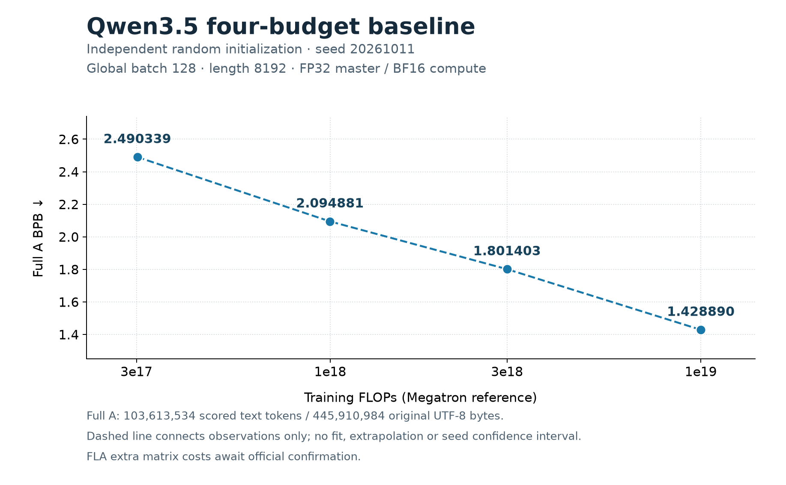

# pretrain_exp

Qwen3.5-0.8B-Base 文本主干预训练。单机 DP2，使用 vendored OLMo-core、FlashAttention2 和 FLA；随机初始化，8个官方训练分片直接流式读取 `.jsonl.zst`。开发流程见 [DEVELOPING.md](DEVELOPING.md)。

## 环境与输入

使用已有环境，不重新安装另一套 OLMo：

```bash
conda activate olmo
python -m pip check
# requirements.txt 是兼容依赖清单；共享环境变更由维护者协调。
```

运行日志、评估结果和校准证据放在开发目录下的独立 runtime 目录；固定 tokenizer 资产放在 Qwen3.5 配方目录中并忽略 Git。在当前终端按实际目录设置：

```bash
export EXP_DIR=/path/to/dev
cd "$EXP_DIR/pretrain_exp"
export DATA_DIR=/path/to/dolma3
export RUNTIME_DIR="$EXP_DIR/pretrain_exp-runtime"
export TOKENIZER_DIR="$EXP_DIR/pretrain_exp/recipes/qwen35-08b/tokenizer-qwen35"
mkdir -p "$RUNTIME_DIR"
```

`DATA_DIR` 应包含 `dolma3_mix_50B-00000.jsonl.zst` 至 `00007.jsonl.zst`。已有压缩源文件直接使用，不写解压语料或 token 缓存。A评估使用已有 `dolma3_mix_100M_a.jsonl`。

共享机器磁盘空间有限，运行前检查 `$RUNTIME_DIR` 所在磁盘的剩余空间。当前四档直接训练并评估内存中的最终权重，不保存 checkpoint；保留配置、逐步日志、结果和全部成本。中断后需从随机初始化重跑该档，失败与重跑成本均保留。评估缓存只创建一份，不重复复制语料、tokenizer 或大文件；不删除其他人的文件。

只下载固定版本 tokenizer，不下载模型权重。镜像配置仅作用于当前终端；AutoDL需要加速时可先 `source /etc/network_turbo`（[说明](https://www.autodl.com/docs/network_turbo/)）：

```bash
export HF_ENDPOINT=https://hf-mirror.com
export HF_HUB_DISABLE_XET=1
python - <<'PY'
import os
from huggingface_hub import snapshot_download
snapshot_download(
    'Qwen/Qwen3.5-0.8B-Base',
    revision='dc7cdfe2ee4154fa7e30f5b51ca41bfa40174e68',
    allow_patterns=['tokenizer.json', 'tokenizer_config.json', 'vocab.json',
                    'merges.txt', 'special_tokens_map.json'],
    local_dir=os.environ['TOKENIZER_DIR'],
)
PY
```

## DP2训练

默认每卡 microbatch16，累积4次，每卡每次更新64条，全局batch128、length8192、seed20261011。FP32主参数和optimizer/BF16计算；AdamW LR3e-4、betas0.9/0.95、weight decay0.1、clip1，cosine最低比例0.1。完整激活重计算和1024-token分块CE降低显存占用。单机容器通信默认 `NCCL_P2P_DISABLE=1`，改用已校准的共享内存路径；恢复保持相同设置，只有独立P2P通信检查通过后才覆盖它。

四档各自随机初始化、独立cosine；先提交代码并保持干净版本：

| 预算 | 更新步数 | 输入token位置 | 完整步参考FLOPs | warmup步数 |
| ---: | ---: | ---: | ---: | ---: |
| 3e17 | 55 | 57,671,680 | 301,694,823,746,764,800 | 10 |
| 1e18 | 182 | 190,840,832 | 998,335,598,580,203,520 | 10 |
| 3e18 | 547 | 573,571,072 | 3,000,492,156,172,369,920 | 11 |
| 1e19 | 1823 | 1,911,554,048 | 9,999,812,067,097,313,280 | 36 |

计算预算仅使用 [固定版 Megatron函数](https://github.com/NVIDIA/Megatron-LM/blob/b92c3ed70029005fd5769d2cf4c65bc3d061a74b/megatron/training/training.py)，原件位于 `third_party/megatron/reference.py`，适配器位于 `src/utils/megatron_budget.py`，函数SHA在入口校验。取最近完整更新，误差≤1%；训练每更新5,485,360,431,759,360参考FLOPs，不包含optimizer、通信或激活重计算。FLA chunk额外矩阵运算尚待正式口径确认。

只打印计划，不启动GPU：

```bash
python -m recipes.qwen35-08b.train --budget 300000000000000000 \
  --data-dir "$DATA_DIR" --tokenizer-dir "$TOKENIZER_DIR" \
  --output "$RUNTIME_DIR/plan-unused" --plan
```

工程校准最多8个累计更新，使用新目录，成本独立记录：

```bash
export RUN_DIR="$RUNTIME_DIR/smoke-attempt01"
bash recipes/qwen35-08b/train_qwen35_dp2.sh 300000000000000000 --smoke-steps 2
```

## 训练后直接验证

A仅验证/选型，B不进入反馈。先准备完整A缓存；缓存只保存评估token和mask，不解压训练语料。首次使用新目录，后续各档复用同一缓存。

```bash
python -m eval.native prepare --dataset-path "$DATA_DIR/dolma3_mix_100M_a.jsonl" \
  --tokenizer "$TOKENIZER_DIR" --cache-dir "$RUNTIME_DIR/eval-a-cache"
```

正式四档串行运行，每档新目录。`--no-checkpoints` 关闭保存，`--eval-cache` 在训练结束后直接用内存中的最终权重做完整A验证，复用训练的两个rank和进程组。任何训练或验证失败立即停止后续档：

```bash
set -e
for budget in 300000000000000000 1000000000000000000 3000000000000000000 10000000000000000000; do
  export RUN_DIR="$RUNTIME_DIR/qwen35-${budget}-seed20261011-attempt01"
  bash recipes/qwen35-08b/train_qwen35_dp2.sh "$budget" \
    --no-checkpoints --eval-cache "$RUNTIME_DIR/eval-a-cache" \
    > "$RUNTIME_DIR/qwen35-${budget}-attempt01.log" 2>&1
done
```

已有输出目录禁止覆盖。每档保存配置、环境、数据/tokenizer身份、逐步loss/成本和训练结果；评估覆盖、权重摘要及BPB写入 `$RUN_DIR/eval-a/`，不落盘权重。BPB使用完整A原始UTF-8分母；native耗时含CE，不是正式EvalTime。固定seed保证可追溯，不能宣称bitwise相同。

工程显存和吞吐校准可在前述 smoke 命令末尾加 `--no-checkpoints`，只跑声明的累计步数。正式无checkpoint运行必须提供完整A缓存，不能使用 `--resume`。

保留checkpoint的训练模式仍可使用，命令省略 `--no-checkpoints`。完整恢复需要新输出目录并添加 `--resume /path/to/own/checkpoint/stepN`；并行度、输入、microbatch、源码和调度必须保持一致，累计计算量不会重置。checkpoint训练的独立评估入口仍是 `python -m eval.native evaluate --help`；部分A不输出完整BPB。

## 已有四档结果

[JSONL](docs/bpb-results.jsonl) · [SVG](docs/qwen35-four-tier.svg)



完整A BPB分别为 **2.490339、2.094881、1.801403、1.428890**。结果是固定架构、配方、单seed的四点观测；没有最优架构证明、多seed误差估计或外推拟合。A有历史选型使用，结果为开发验证，正式榜单认证尚未完成。

## Engram 实验配方

`recipes/qwen35-engram/` 在同一 Qwen3.5 主干的第 2、16 层注意力前加入单流 Engram，复用流式 loader、DP2、分块 CE 和完整激活重计算。实现参考 [Engram 论文](https://arxiv.org/abs/2601.07372) 和固定版本的[官方示例](https://github.com/deepseek-ai/Engram/tree/fb7f84a21f91223715394a33a1dc24bbfb7f788e)；原件位于 `third_party/engram/`，只用于核对。

默认使用 2/3-gram、每阶 8 个 head、每 head 64 维、每 head 约 32,768 行的独立素数表，拼接维度 1,024；卷积 kernel4、dilation3。词表归一化只影响 memory 地址，不修改训练 tokenizer、文本、标签或 BPB 分母；行首和原始 EOS 后重置 n-gram 与卷积历史。原始 EOS 出现在正文时也会重置。表参数 LR 为主干的 5 倍，weight decay=0；其余参数沿用主干配方。

这是原 Engram 的单残差流适配，不包含多流 HC、RL、CPU offload 或跨设备表分片。默认 gate 使用论文的归一化点积 sigmoid，`signed_sqrt` 为官方 demo 的可选差异；卷积零初始化，表和 Key/Value 的 normal std0.02、norm epsilon1e-6 为本配方明确选择。卷积零初始化不代表整个 Engram 分支输出为零。

先从固定本地 tokenizer 离线准备 vocabulary map，不读取训练语料或预训练权重。映射和 sidecar 保存在 runtime，训练前核对 backend 哈希、词表长度与 EOS/pad：

```bash
python -m recipes.qwen35-engram.prepare --tokenizer-dir "$TOKENIZER_DIR" \
  --runtime-dir "$RUNTIME_DIR/engram-map-v1"
export ENGRAM_TOKEN_MAP="$RUNTIME_DIR/engram-map-v1/token-map.npy"
python -m recipes.qwen35-engram.train --budget 300000000000000000 \
  --data-dir "$DATA_DIR" --tokenizer-dir "$TOKENIZER_DIR" \
  --engram-token-map "$ENGRAM_TOKEN_MAP" --output "$RUNTIME_DIR/engram-plan-unused" --plan
export RUN_DIR="$RUNTIME_DIR/engram-smoke-attempt01"
bash recipes/qwen35-engram/train_qwen35_engram_dp2.sh 300000000000000000 \
  --smoke-steps 2 --no-checkpoints
```

固定 Megatron 函数没有 Engram 项。`src/utils/engram_budget.py` 单列 Key/Value 与 depthwise Conv 的主要训练计算项，不按整张 embedding 表的参数量计 FLOPs；它遗漏 norm、gate、bias、SiLU、查表梯度加法等，尚不是官方认证的实际计算图账本。计划以主干参考值加该实验附录确定步数，运行始终标记 `engram_experimental`，原始 Megatron 主干累计量与实验附录分别保存。认证前不能将此模式表述为正式比赛候选。恢复仍需同一配置、map、tokenizer、源码和全部训练状态；完整 GPU 恢复是否通过以运行证据为准。

## 检查

自有代码使用 Ruff 和 pre-commit 统一格式与检查；官方评估原件、vendored OLMo 和 Megatron 参考原件不格式化，以保留其身份与哈希。共享 worktree 的个人 hook 安装见 [DEVELOPING.md](DEVELOPING.md)。

```bash
python -m pytest tests -q
pre-commit run --all-files
git diff --check
python -m recipes.qwen35-08b.train --help
```

首次提交前由维护者先 `git add .`，再运行 `pre-commit run --all-files`；空索引不能检查尚未加入 Git 的文件。若格式工具修改了文件，检查改动、重新暂存并再次运行，全部通过后再提交。

## 目录

- `recipes/qwen35-08b/`：本模型训练入口、DP2启动脚本、模型配方、固定配置和本地 tokenizer 资产。
- `recipes/qwen35-engram/`、`src/arch/memory/`：Engram 实验配置、离线映射准备、启动入口与单流组件。
- `src/arch/`、`src/data/`、`src/train/`：模型、压缩流式数据和训练组件；数据读取所需的 tokenizer 辅助也在 `src/data/`。
- `src/utils/megatron_budget.py`、`third_party/megatron/`：官方参考计算预算的适配器与原件。
- `docs/`：本模型已有四档结果图与 JSONL。
- `$RUNTIME_DIR/`：每次运行的日志、评估结果、校准和失败证据，不加入 Git。当前四档不保存 checkpoint。
